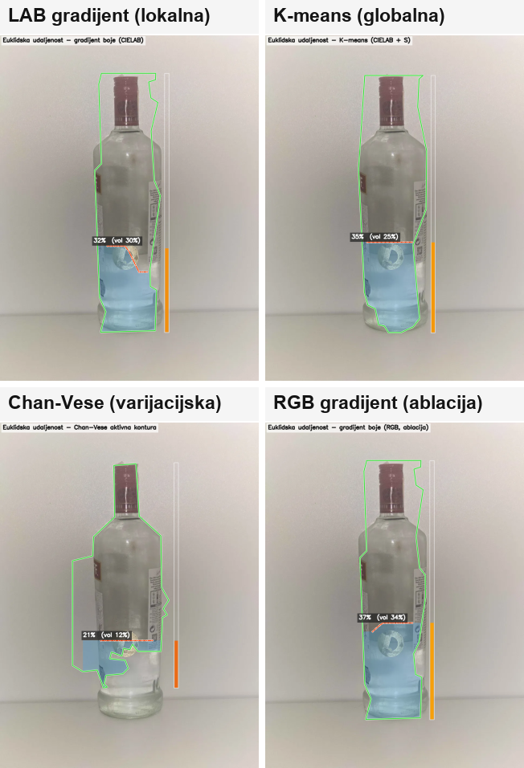
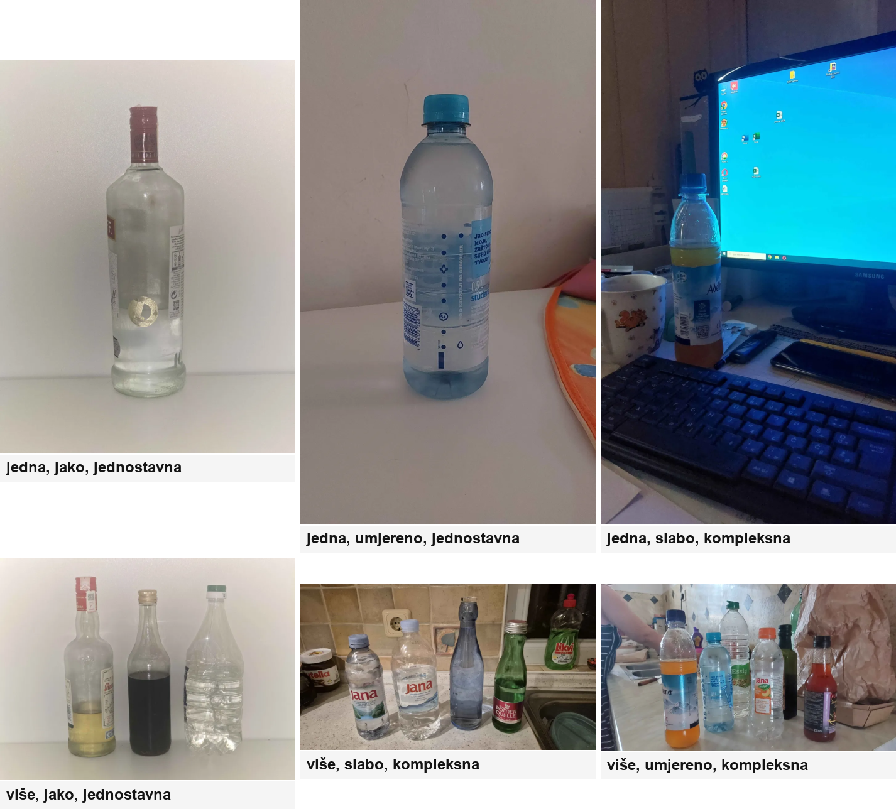
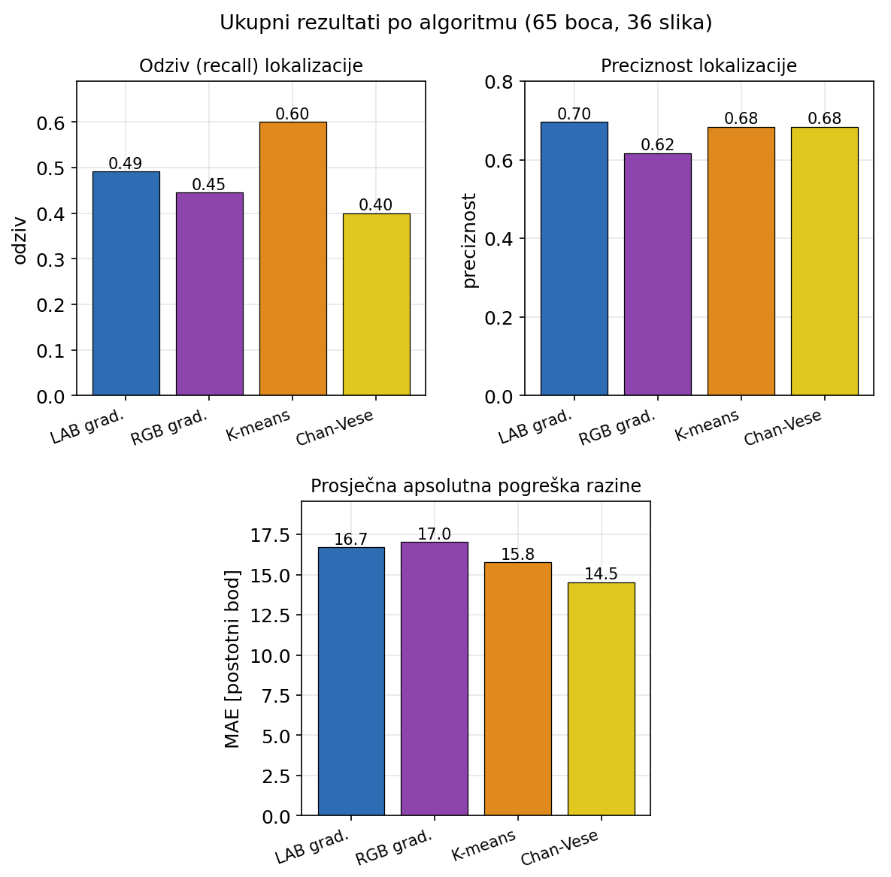
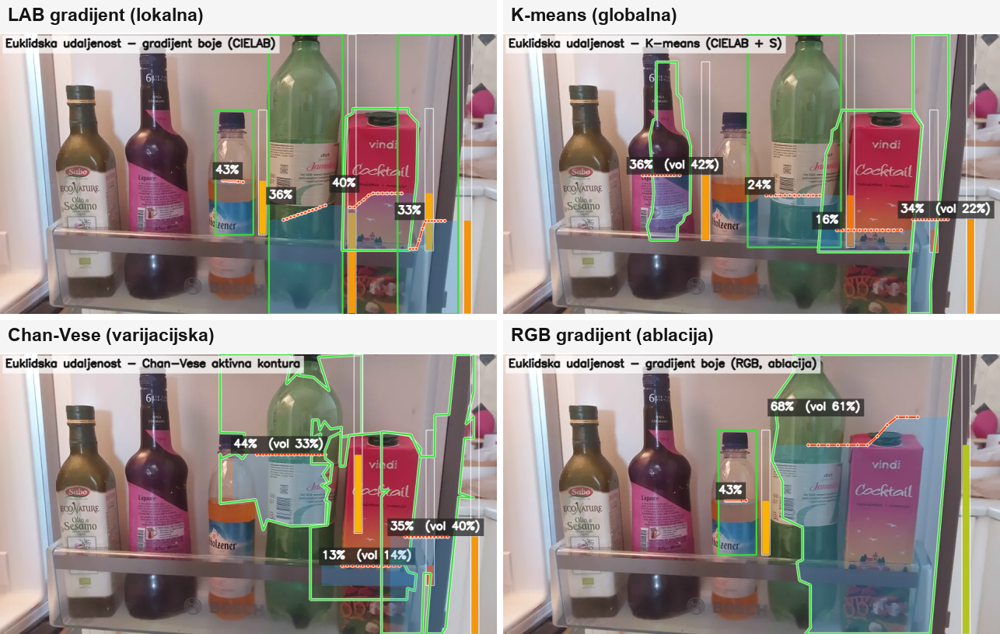

# Bottle Fill-Level Detection

**Detecting bottles and estimating liquid levels with classical computer vision and Euclidean distance.**

This project compares CIELAB and RGB color gradients, K-means clustering, and Chan–Vese segmentation on photographs of bottles. It draws bottle outlines and liquid boundaries, estimates fill percentages, and evaluates the results against manual annotations. All four methods use OpenCV and NumPy, with no model training required.

Developed by **Matej Abramović** for a master's thesis at **Juraj Dobrila University of Pula (2026)**, with industrial visual inspection as the intended application.



## What it does

- Finds one or more bottles in a photograph.
- Estimates the boundary between air and liquid inside each detected bottle.
- Draws the outline, liquid boundary, fill gauge, and estimated percentage.
- Measures detection quality, fill-level error, and processing time.

## Methods

Euclidean distance provides a common measure, applied in three different ways:

| Method | How it uses distance | Main finding |
| --- | --- | --- |
| **CIELAB gradient** | Measures color differences between neighboring pixels in CIELAB space. | Fast, with the highest overall detection precision. |
| **K-means** | Groups pixels by distance to cluster centers, using color, saturation, and position for localization. | Finds the most bottles, with the longest processing time. |
| **Chan–Vese** | Separates regions using squared distances to their mean colors and morphological smoothing. | Lowest fill-level error among matched detections. |
| **RGB gradient** | Runs the gradient method in RGB/BGR space to test the effect of color space. | Fast baseline; lower precision and recall than CIELAB. |

After localization, each bottle is divided into vertical segments to search for the liquid boundary. The segment estimates are combined into an approximately horizontal line. Fill percentage measures the filled share of the bounding-box height:

```text
fill (%) = 100 × (bottom of box − liquid boundary) / box height
```

An optional volume estimate uses the silhouette width, assuming a rotationally symmetric bottle. This is a shape-based approximation without physical camera calibration.

Implementations: [CIELAB](algoritmi/lab_euklidska.py), [RGB](algoritmi/rgb_euklidska.py), [K-means](algoritmi/kmeans_euklidska.py), [Chan–Vese](algoritmi/chanvese_euklidska.py), and [shared utilities](algoritmi/common.py).

## Dataset

The evaluation set contains **36 photographs and 65 manually annotated bottles**, covering glass and plastic bottles, transparent and colored contents, single bottles and groups, three lighting categories, and simple or cluttered backgrounds. Fill levels range from approximately **18–86%**.

Each reference annotation records a bottle bounding box and the liquid boundary's vertical position. Annotations are stored in [ground_truth.json](evaluacija/ground_truth.json).



## Results

| Method | Matched bottles / 65 | Precision | Recall | Mean IoU | MAE (pp) | RMSE (pp) | Time / image (s) |
| --- | ---: | ---: | ---: | ---: | ---: | ---: | ---: |
| CIELAB gradient | 32 | **0.696** | 0.492 | 0.752 | 16.69 | 22.72 | 0.255 |
| RGB gradient | 29 | 0.617 | 0.446 | 0.767 | 17.02 | 23.71 | **0.249** |
| K-means | **39** | 0.684 | **0.600** | 0.767 | 15.77 | 21.32 | 2.199 |
| Chan–Vese | 26 | 0.684 | 0.400 | 0.738 | **14.53** | **19.29** | 1.040 |

Values are rounded from the [saved evaluation summary](evaluacija/rezultati/sazetak.csv). Timings describe the reported experiment and depend on hardware and image size.

Detections are matched to reference bottles at **IoU ≥ 0.4**. Precision measures how many detections are correct; recall measures how many reference bottles are found. Mean IoU and fill-level errors use **successfully matched bottles only**. MAE and RMSE are expressed in **percentage points**: predicting 60% for a bottle annotated at 50% gives an absolute error of 10 pp.



K-means provides the broadest detection coverage, while Chan–Vese gives more accurate level estimates on the bottles it finds. The gradient methods offer the shortest processing times. The thesis also reports a median ensemble covering **44 bottles with 14.2 pp MAE**.

### A more difficult scene

Clutter, reflections, and weak boundaries can cause missed bottles and incorrect level estimates:



The dataset is small, and lighting categories differ in scene complexity, so category results do not isolate the effect of lighting alone. Production use would require validation under the intended camera, lighting, and inspection conditions.

## Getting started

The implementation was developed with **Python 3.13**, **OpenCV**, and **NumPy**. From the repository root:

```sh
python -m pip install numpy opencv-python
python main.py
```

Place images directly in `boce/`. Supported formats are JPEG, PNG, BMP, WebP, and TIFF. The terminal menu is in Croatian:

| Option | Action |
| --- | --- |
| `1` | CIELAB gradient |
| `2` | K-means |
| `3` | Chan–Vese |
| `4` | Run the three main methods |
| `5` | RGB gradient comparison |
| `0` | Exit |

Annotated images are saved to `boce_obradeno/<method>/`. Running a method again overwrites its corresponding output images.

## Evaluation tools

Run these commands from the repository root, with the annotated source images available in `boce/`:

```sh
# Evaluate all four methods against the manual annotations
python -m evaluacija.pokreni_evaluaciju

# Draw reference levels alongside matched algorithm estimates
python -m evaluacija.usporedba

# Inspect results by scene category
python -m evaluacija.evaluacija_po_kategorijama
```

The main evaluation refreshes CSV reports in `evaluacija/rezultati/` and appends results to `povijest.csv`. Visual comparisons are saved in `evaluacija/usporedba/`.

To create or edit reference annotations interactively:

```sh
python -m evaluacija.oznacavanje
```

This tool saves changes to `evaluacija/ground_truth.json`.

## Repository layout

```text
main.py                  Interactive entry point
algoritmi/               Four methods and shared image-processing functions
boce/                    Input photographs
boce_obradeno/           Annotated outputs, grouped by method
evaluacija/              Annotation, evaluation, calibration, and comparison tools
  ground_truth.json      Manual bottle and liquid-level annotations
  rezultati/             Saved CSV reports
pisanje/slike_rada/      Figures used in the thesis and this README
kronoloski/              Development notes and image categorization thresholds
```

## About the research

- **Author:** Matej Abramović
- **Institution:** Juraj Dobrila University of Pula
- **Year:** 2026

Thesis title: *Analiza algoritama detekcije rubova temeljenih na euklidskoj udaljenosti s primjenom u sustavima industrijske vizualne inspekcije*.

The thesis is written in Croatian. It also discusses Roberts, Sobel, Prewitt, Canny, and distance transforms as background comparisons. The quantitative bottle evaluation presented here covers the four implemented methods above.
